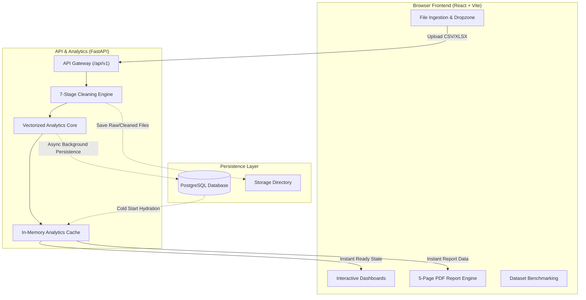

# Acuity: Enterprise Customer & Retail Analytics Platform
> *From raw noise to refined insight*

Acuity is an end-to-end customer intelligence and retail revenue diagnostics platform. It transforms raw transaction logs into executive dashboards, RFM segmentations, cohort retention matrices, returns leakage diagnostics, demand anomaly alerts, churn risk indices, and multi-page board-level PDF reports.

---

## 1. Executive Summary

Traditional retail reporting often relies on static spreadsheets or unverifiable models. Acuity bridges this gap with an automated deterministic cleaning pipeline, rigorous statistical analytics, asynchronous database persistence, and interactive visualization.

**Key Highlights:**
- **Automated Data Cleaning**: Ingests multi-MB CSV/Excel logs, resolving cancellations, stripping non-product charges, and sanitizing pricing.
- **RFM Segmentation**: Deterministic quintile-based scoring categorizing buyers into 6 actionable lifecycle tiers.
- **Cohort Retention**: Triangle heatmaps and retention decay curves tracking customer volume and net revenue over 12+ months.
- **Returns Leakage**: Identifies high-return SKUs and customer segments eroding gross margins against portfolio benchmarks.
- **Demand Anomaly Detection**: 30-day rolling Gaussian z-score calculations flagging demand spikes and drops with customer attribution.
- **Multi-Factor Churn Risk**: Composite risk scoring (0–100) combining RFM decay, return propensity, and purchase interval changes.
- **Dataset Comparison**: Side-by-side benchmarking between baseline periods and active uploads with scale normalization.
- **Executive PDF Reporting**: Generates 5-page vector PDF reports with KPI scorecards, risk watchlists, and a 90-day action roadmap.

---

## 2. Technology Stack

| Layer | Technologies | Role |
|---|---|---|
| **Frontend** | React 18, TypeScript, Vite | Ultra-fast HMR, strict type safety, responsive layout |
| **Styling** | Tailwind CSS v4, Vanilla CSS tokens | Custom corporate design system with dark mode |
| **Visualization** | Apache ECharts 6 (`echarts-for-react`) | Interactive, GPU-accelerated charts and graphs |
| **State & Data** | Zustand, TanStack Query | Reactive client state and zero-latency caching |
| **Backend** | FastAPI, Uvicorn | Asynchronous Python REST API with background workers |
| **Analytics** | Pandas, NumPy, Statsmodels | Vectorized data processing and statistical time-series |
| **Database** | PostgreSQL, SQLAlchemy 2 | Relational storage with cascade integrity and async persistence |
| **Export** | jsPDF, autoTable, OpenPyXL | 5-page board reports, Excel cleaning sheets, CSV exports |

---

## 3. Architecture & Data Flow

Acuity processes uploads in an asynchronous pipeline: in-memory analytics execute immediately so the web dashboard is responsive without delay, while transactional persistence to PostgreSQL runs concurrently in the background.



---

## 4. Data Cleaning Pipeline

Raw transaction logs pass through a 7-stage deterministic pipeline in `backend/app/cleaning.py`:

1. **Header Normalization**: Maps diverse column names to standard schema (`InvoiceNo`, `StockCode`, `Quantity`, `InvoiceDate`, `UnitPrice`, `CustomerID`).
2. **Cancellation Matching**: Pairs negative return rows (`C` prefix) against matching sales invoices to accurately determine net revenue.
3. **Non-Product Filtering**: Isolates shipping, postal, and fee codes (`POST`, `DOT`, `BANK CHARGES`, etc.) from physical catalog sales.
4. **Price & Currency Sanitization**: Strips international currency symbols (GBP, EUR, USD, INR), removes commas, and parses valid numeric values.
5. **Customer ID Resolution**: Separates anonymous checkout rows from authenticated customer IDs to prevent RFM skew.
6. **Deduplication**: Eliminates duplicate transaction entries caused by multi-channel synchronization lags or retry loops.
7. **Dataset Segregation**: Produces cleaned master datasets, segregating transactions into sales and returns with computed `LineValue`.

---

## 5. Core Analytics Engines

- **RFM Segmentation**: Evaluates Recency, Frequency, and Monetary metrics across quintile scoring (1–5) to classify buyers into **Champions**, **Loyal**, **Promising**, **New**, **At-Risk**, and **Lost** cohorts.
- **Cohort Retention**: Constructs 13-month triangle matrices and decay curves tracking both customer count and revenue retention from initial acquisition.
- **Returns Intelligence**: Calculates return rates across SKUs, segments, and months, flagging items exceeding portfolio averages by >1.0 standard deviation.
- **Demand Anomaly Engine**: Computes 30-day rolling Gaussian z-scores (`|z| > 2.0`) to detect volume spikes or revenue dips, attributing affected buyers and SKUs.
- **Composite Churn Risk**: Blends RFM decay, customer return propensity, purchase interval acceleration, and volatility exposure into a 0–100 risk score.
- **Dataset Comparison**: Benchmarks two datasets side-by-side with automatic scale normalization, growth trajectory tracking, and segment migration analysis.

---

## 6. Key Dashboards & Visualizations

| Dashboard | Visualizations | Analytical Focus |
|---|---|---|
| **Overview** | Monthly Sales vs Returns, Segment Mix Donut, Leakage Waterfall | High-level portfolio KPIs, return deductions, net cash capture |
| **Compare** | Monthly Sales Trajectory (Dual Line), Segment Migration (Grouped Bar) | Trajectory shifts and customer cohort migration vs benchmark |
| **Customer Journey** | Order Frequency, Inter-Purchase Gaps, Lorenz Curve, Acquisition Pace | Purchase intervals, repeat loyalty patterns, revenue concentration |
| **RFM Segments** | Multi-dimensional Bubble Scatter Plot, Segment Distribution | Customer clustering by Recency/Frequency scaled by spend |
| **Cohorts** | Triangle Retention Heatmap, Multi-Cohort Decay Curves | 12-month customer longevity and revenue decay |
| **Returns** | Return Rate by SKU/Segment/Month, Share of Sales vs Returns | Product defect identification and operational return leakage |
| **Risk Radar** | Risk Decile Distribution, Average Segment Risk, Key Account Watchlist | Churn probability (0–100) and revenue-at-risk prioritization |
| **Anomalies** | Daily Revenue vs Rolling Z-Score (\|z\| > 2.0), Spike/Drop Annotations | Flash sales, bulk wholesale purchases, operational stockouts |

---

## 7. 5-Page Board-Ready PDF Report

The client-side PDF generator (`frontend/src/lib/pdf-report.ts`) produces an executive presentation report:
- **Page 1: Executive KPI Scorecard**: Corporate header, 6 core KPIs, leakage reconciliation, and monthly net revenue trajectory chart.
- **Page 2: Lifecycle & RFM Segmentation**: Full segment breakdown, revenue concentration commentary, and quintile scoring rules.
- **Page 3: Churn Risk Radar**: Total capital exposed, risk tier distributions, and top-15 high-risk account watchlist with recommended actions.
- **Page 4: Product Catalog & Return Leakage**: Top revenue SKUs, high-return catalog lines, and supplier QA mitigation guidelines.
- **Page 5: Demand Anomalies & Action Roadmap**: Timeline of significant daily shocks and a phased 90-day strategic implementation plan.

---

## 8. REST API Summary

Interactive Swagger API docs are available at `http://localhost:8000/docs`. All routes are prefixed with `/api/v1`.

| Category | Endpoint | Method | Description |
|---|---|---|---|
| **Datasets** | `/datasets/upload` | `POST` | Ingest CSV/Excel file; triggers instant in-memory processing |
| | `/datasets/status` | `GET` | Polling endpoint for ingestion state (`idle`, `processing`, `ready`) |
| | `/datasets` | `GET` | List all stored datasets with row counts and active status |
| | `/datasets/{id}` | `DELETE` | Delete dataset with automatic cascade deletion across child tables |
| | `/datasets/clear` | `POST` | Purge all database records and delete temporary storage files |
| **Analytics** | `/datasets/overview` | `GET` | Headline KPIs, monthly trends, and segment breakdowns |
| | `/datasets/report-data` | `GET` | Pre-aggregated dataset structures for 5-page PDF report |
| | `/datasets/journey` | `GET` | Paginated customer journey and purchase interval metrics |
| | `/datasets/segments` | `GET` | Paginated RFM quintile scores and segment assignments |
| | `/datasets/cohorts` | `GET` | 13-month triangle customer and revenue retention matrix |
| | `/datasets/returns` | `GET` | Leakage metrics grouped by SKU, segment, or month |
| | `/datasets/products` | `GET` | Product catalog performance, return rates, and volume ranks |
| | `/datasets/anomalies` | `GET` | Daily rolling Gaussian anomaly scores and flagged dates |
| | `/datasets/risk` | `GET` | Churn risk scores (0–100) with configurable factor weights |
| **Export** | `/datasets/export/{table}.csv` | `GET` | Stream analytical tables (`rfm`, `risk`, `journey`, etc.) as CSV |
| | `/datasets/cleaned-file` | `GET` | Download processed Excel workbook with Sales/Returns split |

---

## 9. Quick Start Guide

### Prerequisites
- **Node.js**: v18+
- **Python**: v3.10+
- **PostgreSQL**: v14+ (optional, fallback in-memory caching included)

### Backend Setup
```bash
cd backend
python -m venv venv
.\venv\Scripts\activate       # On Linux/macOS: source venv/bin/activate
pip install -r requirements.txt
python scripts/init_db.py     # Initialize PostgreSQL schema
uvicorn app.main:app --reload --port 8000
```

### Frontend Setup
```bash
cd frontend
npm install
npm run dev
```
Open **`http://localhost:3000`** in your browser.

To verify the production build:
```bash
cd frontend
npm run build
```

---

## 10. License

This project is licensed under the MIT License.
